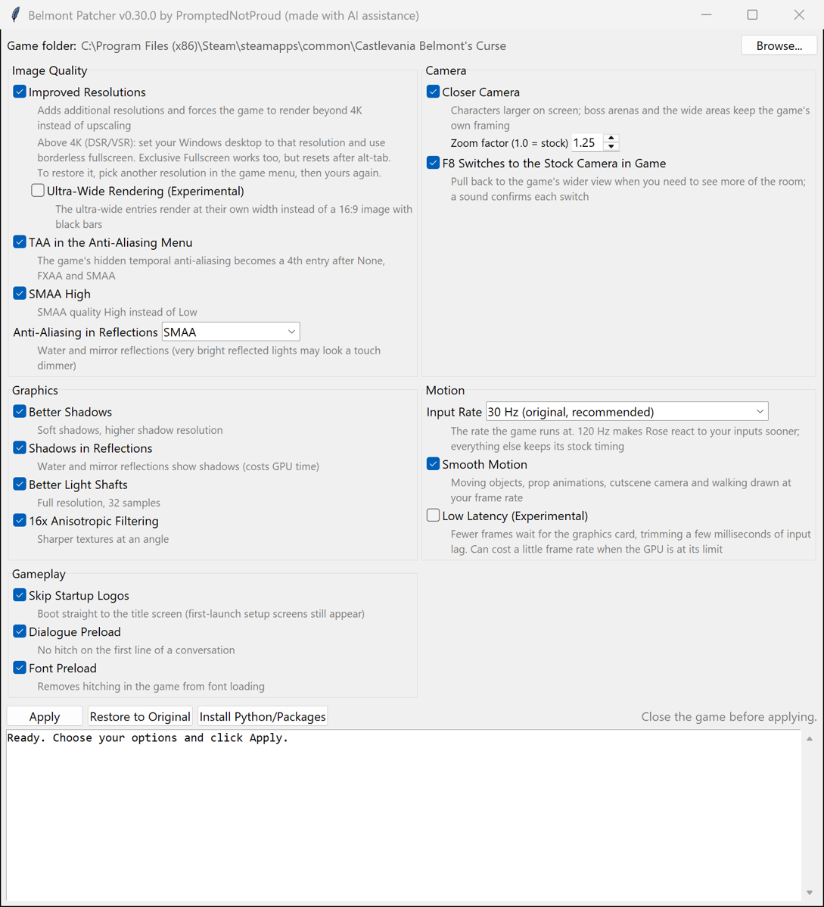

# Belmont Patcher

**Unofficial fan patch for *Castlevania: Belmont's Curse* on Steam (PC).**
By PromptedNotProud (made with AI assistance)

<!-- Your own disclosure paragraph goes here. -->

The game keeps playing exactly as it does now (same physics, same controls, same timing), but it is drawn smoothly at your
monitor's frame rate, looks sharper, and no longer freezes on the first line of each conversation or hitches from font loading. There is also an
optional, experimental 120 Hz input mode that makes Rose react to your inputs sooner.

**[Download the latest release](../../releases/latest)**

## What it does

**Image Quality**
- **Improved Resolutions**: adds resolutions from 1280x720 to 7680x4320 and makes the game render beyond 4K instead of
  upscaling. Every entry in the game's menu is the size you actually get.
  **Above 4K (DSR/VSR):** set your Windows desktop to that resolution and use borderless fullscreen. Exclusive
  Fullscreen works too, but resets after alt-tab. To restore it, pick another resolution in the game menu, then yours
  again.
- **Ultra-Wide Rendering** *(experimental, off by default)*: 2560x1080, 3440x1440 and 5120x1440 render at their full width
  instead of a 16:9 image with black bars.
- **TAA in the Anti-Aliasing Menu**: the game ships Unity's temporal anti-aliasing but hides it; it becomes a 4th entry
  after None, FXAA and SMAA.
- **SMAA High**, and **anti-aliasing in reflections** (Off / SMAA / TAA) for water and mirrors.

**Graphics**
- Better shadows, shadows in reflections, better light shafts, 16x anisotropic filtering.

**Camera**
- **Closer Camera**: characters about 25% larger on screen (adjustable). It zooms in toward Rose, so she keeps her
  place on screen. Boss arenas, deliberately wide areas and the special cameras the game zooms out to keep the original
  framing.
- **F8** pulls back to the game's wider view in game when you need to see more of the room, and back to the closer
  camera.

**Motion**
- **Smooth Motion**: the game simulates at 30 frames per second. It already draws the player and enemies smoothly in
  between; this extends that to everything else: water wheels, moving platforms, gates, saws, projectiles, cutscene props,
  camera blends and characters walking in cutscenes.
- **120 Hz input** *(experimental, off by default)*: every character and object still runs its original 30 Hz code, so
  movement, hits and timing are identical. Only the moment Rose's next frame starts changes: on the next 1/120 s after you
  press a button, instead of the next 1/30 s. Up to 25 ms less input lag; measured inside the game, the time from a
  key press to Rose moving dropped from about 48 ms to 35 ms on average.
- **Low Latency** *(experimental, off by default)*: one frame waits for the graphics card instead of Unity's default
  two. About 2 ms less input lag with 30 Hz input and 4 to 5 ms with 120 Hz input, measured inside the game. It can
  cost a little frame rate when the GPU is at its limit. NVIDIA's Low Latency Mode isn't needed with it.

**Gameplay**
- **Skip Startup Logos**: boots straight to the title screen.
- **Dialogue Preload**: removes the short freeze on the first line of every conversation.
- **Font Preload**: removes hitching in the game from font loading.

## Install

1. In Steam: right-click the game > **Manage** > **Browse local files**.
2. Copy the **Belmont Patcher** folder from the zip into that folder.
3. Close the game and double-click **Install.bat**. If Python isn't on your PC, it offers to install it for you
   (official installer from python.org, no admin rights needed).
4. In the window, click **Apply**. The first run downloads one Python package and takes a few minutes.
5. Start the game from Steam.

To change an option later, close the game, open Install.bat again, change it and click **Apply**.

## Uninstall

Open Install.bat and click **Restore to Original**, or use Steam's **Verify integrity of game files**.

## After a game update

Open Install.bat and click **Apply** again. The patcher finds every change by searching for the surrounding code, so most
updates work without a new version. Anything it can't find is skipped and shown as NOT FOUND in the log.

## Is it safe?

- No game files are included. The patcher edits your own copy and keeps the originals in `Belmont Patcher\stock`, so
  everything can be undone.
- `belmont_patcher.py` is a plain Python script; open it in any text editor to see what it does.
- The only downloads are Python itself (python.org, only if missing) and the UnityPy package with its dependencies (PyPI).

## Requirements

Windows 10 or 11 and the Steam version of *Castlevania: Belmont's Curse* (the demo works too).

## Known limitations

- Ultra-wide rendering hasn't been tested on an ultra-wide monitor yet. The game was designed for 16:9, so the edges of
  some rooms may show things that were meant to stay off-screen.
- TAA in reflections, Low Latency and the 120 Hz input mode are experimental. If something looks wrong, switch the option off and
  click Apply.

Bug reports are welcome on the [Issues](../../issues) page. Please include the text from the patcher's log window.

---

Released under the MIT License (see [LICENSE](LICENSE)). Not affiliated with or endorsed by Konami. *Castlevania* is a
trademark of Konami Digital Entertainment. Use at your own risk.
